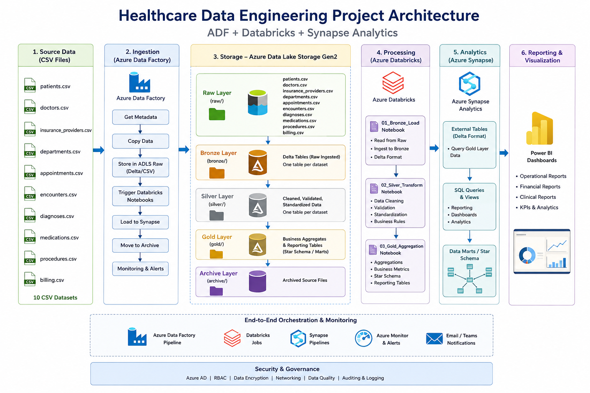

# 🏥 Healthcare Data Platform

**Medallion lakehouse on Azure Databricks, with a dbt modeling layer that turns 10 raw hospital datasets into a tested star schema.**


---

## What this project does

A hospital's operational data (patients, doctors, departments, appointments, encounters, diagnoses, procedures, medications, insurance and billing) lands as raw CSVs. This project moves it through **Bronze → Silver → Gold** on Databricks and models it into a **star schema** that answers clinical and financial questions such as:

- How many encounters does each department and doctor handle, and how severe are the diagnoses?
- What does each encounter cost, how much was billed, and how much did insurance vs. the patient pay?
- How much revenue is still **outstanding**, and with which insurance providers and plan types?

## Architecture



| Layer | Where | What happens |
|---|---|---|
| **Raw / Bronze** | ADLS Gen2 → Databricks (Unity Catalog `healthcare.bronze`) | 10 CSV datasets ingested as Delta tables, one per source |
| **Silver** | dbt `staging` (views) + `intermediate` (tables) | Staging selects columns 1:1 from Bronze; intermediate joins and enriches patient, encounter, billing and clinical entities |
| **Gold** | dbt `marts` (tables) | 5 dimensions + 2 facts, with tests on keys and relationships |
| **Serving** | Gold tables | Ready for BI (Power BI / Tableau) or SQL analytics |

> The Azure setup (resource group, ADLS containers, Databricks access connector, Unity Catalog external locations) follows a community tutorial included in [`Project-documentation/`](Project-documentation). **The dbt project in this repo is my own extension:** it replaces notebook-based Silver/Gold logic with modular, tested SQL models.

## dbt project: [`dbt-healthcare/healthcare_dbt`](dbt-healthcare/healthcare_dbt)

```
models/
├── staging/        10 models  → views in silver   (1:1 with bronze sources)
├── intermediate/    7 models  → tables in silver  (joins + enrichment)
└── marts/           7 models  → tables in gold    (star schema)
```

**Star schema (Gold)**

| Model | Grain | Highlights |
|---|---|---|
| `fact_encounter` | one row per patient encounter | diagnosis count, high-severity diagnosis count, procedure count and cost, billed / insurance-paid / patient-paid / **outstanding** amounts |
| `fact_billing` | one row per bill | payment status, plan type, outstanding amount; keeps the source `billing_patient_id` to investigate billing-vs-encounter patient mismatches |
| `dim_patient`, `dim_doctor`, `dim_department`, `dim_insurance`, `dim_date` | one row per entity / day | conformed dimensions |

**Engineering choices**
- **Pre-aggregate, then join.** Diagnoses, procedures and billing are each summarised per encounter in CTEs *before* joining to encounters, so a fact row never fans out.
- **Null-safe measures.** `COALESCE` on every amount, so an unbilled encounter shows 0 instead of NULL.
- **Custom `generate_schema_name` macro** writes models to clean `silver` / `gold` schemas instead of dbt's default `<target>_<schema>` prefixing.
- **Layer-level materialisation** in `dbt_project.yml`: staging as views (cheap, always fresh), intermediate and marts as tables.

**Data tests (20):** `unique` + `not_null` on every dimension key and the encounter key, plus `relationships` tests from `fact_encounter` to all four dimensions it references, so an orphaned foreign key fails the build.

## Run it

```bash
cd dbt-healthcare/healthcare_dbt
dbt deps                 # installs dbt_utils
dbt build                # runs models + tests
dbt docs generate && dbt docs serve
```

Requires a `healthcare_dbt` profile pointing at a Databricks SQL warehouse with the `healthcare` Unity Catalog and the Bronze tables loaded.

## Dataset

Synthetic hospital data in [`Dataset/`](Dataset): 10 tables (200 rows each for transactional tables; 20 doctors, 8 departments, 10 insurance providers). No real patient data.

## What I'd add next

- Incremental models for `fact_encounter` and `fact_billing`
- A snapshot (SCD Type 2) on `dim_patient` to track insurance and address changes
- `accepted_values` tests on status fields, and source freshness checks
- CI: `dbt build` on every pull request against a dev schema
